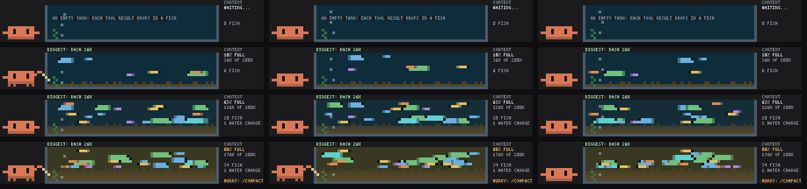

# context-aquarium

A Claude Code mod. The context window as a fish tank above the prompt: each tool result drops in a fish sized by its tokens, and the water murks as compaction nears. /context-aquarium toggles it.



*Preview frames rendered from the mod's own drawing code.*

**It won't use any of your usage.** Everything is drawn locally from code: no model calls, no tokens.

## Install

```
/plugin marketplace add saiharsha03/context-aquarium
/plugin install context-aquarium@context-aquarium
```

Or from a clone: `claude --plugin-dir ./context-aquarium`.

## Where it shows

In the band above the prompt, hidden until `/context-aquarium`. Terminal only.

## Commands

- `/context-aquarium`

## What the hooks do

`hooks/register.tsx` hooks: session.start, tool.call, session.measure, session.compact, command.run{command=context-aquarium}, ui.render{component=AbovePrompt}. It never blocks or rewrites a tool call or a prompt; it only watches them, draws, and answers its own commands.

## Privacy: what data it sends

None. It makes no network or model calls; anything it remembers stays in Claude Code's local plugin storage on your machine.

## Licence

MIT. Clawd is Anthropic's Claude Code mascot; this is an unofficial fan mod.
